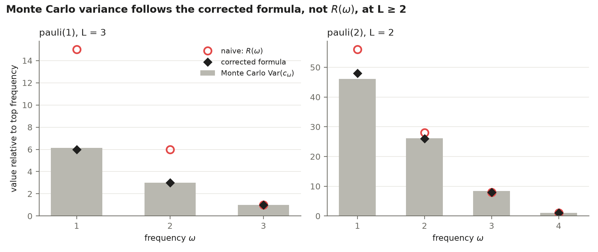
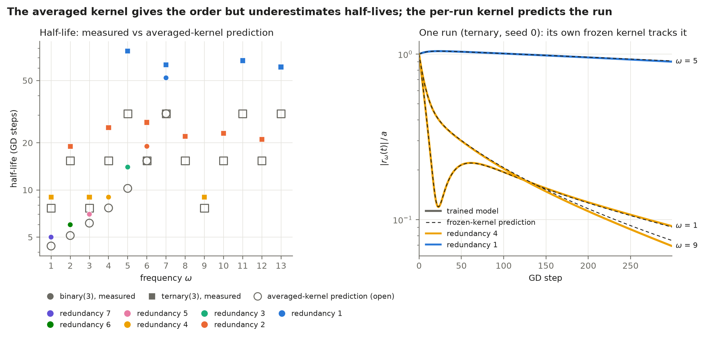
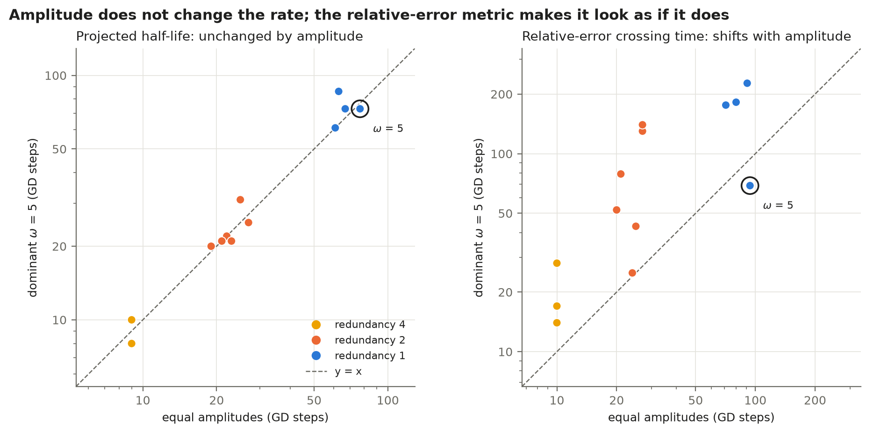

# QNN frequency-order MVP

A small numerical experiment on a 3-qubit data re-uploading quantum neural network (QNN). It asks what sets the order in which gradient descent learns the Fourier components of a target: the redundancy of each frequency, low frequency first, or the target's amplitude.

The model output is a Fourier series, f(x) = Σ_ω c_ω(θ) e^{iωx}. The redundancy r₁(ω) is the number of pairs of encoding-generator eigenvalues that differ by ω. Three experiments separate the candidate answers:

1. **Theory check (no training).** Monte Carlo over Haar-random blocks tests the corrected variance formula for c_ω and the Fourier tangent kernel identity, against the naive prediction "rate ∝ R(ω)".
2. **Learning order.** The same circuit is trained with a binary encoding (redundancy falls with ω) and a ternary encoding (redundancy is not monotone in ω).
3. **Amplitude.** One frequency is given 9× the amplitude of the others, and two metrics are compared.

## How to run

```
python -m venv .venv
.venv/bin/pip install -r requirements.txt
.venv/bin/python run_all.py      # about 20 s on a laptop CPU
.venv/bin/python -m pytest       # 5 fast tests, no training
```

Python ≥ 3.10, CPU only. `run_all.py` regenerates `results/` and `figures/` from scratch and rewrites the acceptance table below.

## Figures

**Figure 1.** At L ≥ 2 the Monte Carlo variance of c_ω follows the corrected formula; R(ω) overestimates the low frequencies by up to 2.5×.



**Figure 2.** Frequencies are learned in order of redundancy: that is low-frequency-first for the binary encoding, but for the ternary encoding ω = 9 (redundancy 4) is learned long before ω = 5 (redundancy 1).


**Figure 3.** The averaged kernel predicts the order of the half-lives but underestimates them, by more as redundancy falls (left); each run's own kernel, frozen at initialisation, reproduces that run's trajectory (right).



**Figure 4.** Giving ω = 5 nine times the amplitude leaves the projected half-lives close to the y = x line (left), while under the relative-error metric the other frequencies appear slower and ω = 5 faster (right).



Colours in figures 2–4 denote the single-layer redundancy r₁(ω). Figure 1 compares quantities at L ≥ 2, where r₁ is not the relevant grouping, so it uses neutral bars and two marker styles instead.

## Acceptance checks

Expected values are from a prototype run with the reference core. The table is written by `run_all.py`; every number is also in `results/summary.json`.

<!-- ACCEPTANCE:START -->
| # | Check | Expected (prototype) | Measured | Result |
| --- | --- | --- | --- | --- |
| 1 | Exp 1: MC Var / predicted, every ω ≥ 1, all configurations | 0.88–1.08 | 0.881–1.077 | pass |
| 2 | Exp 1: MC kernel diagonal / ((L+1)(d²/2)·Var), every ω ≥ 1 | 0.95–1.05 | 0.951–1.052 | pass |
| 3 | Exp 1, pauli(1), L = 3: predicted Var at ω = 1, 2, 3 | 6/81, 3/81, 1/81 | 6/81, 3/81, 1/81 | pass |
| 4 | Exp 2 binary: half-lives for ω = 1…7 | 5, 6, 7, 9, 14, 19, 52 | 5, 6, 7, 9, 14, 19, 52 | pass |
| 5 | Exp 2 ternary: half-lives by redundancy group | R=4: 9; R=2: 19–27; R=1: 61–77 | R=4: 9–9; R=2: 19–27; R=1: 61–77 | pass |
| 6 | Exp 2 ternary: half-life(ω = 5) / half-life(ω = 9) | 8.6 | 8.56 | pass |
| 7 | Exp 2 ternary: seed-mean kernel diagonal × η vs predicted rate (0.0903, 0.0451, 0.0226 for R = 4, 2, 1) | largest deviation 10% | group means 0.0901, 0.0449, 0.0234; largest deviation 10.5% | pass |
| 8 | Exp 2 ternary: max over (t, ω) of seed-mean |r − r_frozen| / a | 0.007 | 0.00716 | pass |
| 9 | Exp 2 ternary: measured / predicted half-life, mean per group (R = 4, 2, 1) | 1.2, 1.5, 2.2 | 1.17, 1.49, 2.18 | pass |
| 10 | Exp 3: projected half-life, dominant / equal, every ω | 0.9–1.4 | 0.89–1.37 | pass |
| 11 | Exp 3: relative-error crossing time rises for the non-dominant ω | 12 of 12 rise, by 1.04–5.2× | 12 of 12 rise, ratios 1.04–5.19× | pass |
| 12 | Exp 3: relative-error crossing time of ω = 5 | falls from 94 to 69 | 94 → 69 | pass |

12 of 12 checks pass. Last full run: 17 s.
<!-- ACCEPTANCE:END -->

## Conventions

- Circuit U(x) = W_L S(x) … S(x) W_0 on |0…0⟩, with S(x) = diag(exp(−i x λ_j)) and W_l = V_l · expm(−(i/2) Σ_k θ_{l,k} P_k), where V_l is a fixed Haar-random unitary and P_k runs over all d² − 1 non-identity Pauli strings. θ = 0 at initialisation. Observable: Z on the first qubit.
- Training uses the zero-output model f = (f_A − f_B)/√2 (shared V_l, separate parameters), loss ½·mean over the grid of (f − y)², full-batch gradient descent with η = 0.2 for T = 300 steps, seeds 0–99.
- Grid x_j = 2πj/N with N = 2K + 3; c_ω is the FFT of f over the grid divided by N.
- Projected residual ρ_ω(t) = Re(r_ω(t)·conj(r_ω(0)))/|r_ω(0)|², averaged over seeds; its half-life is the first step with mean ρ_ω < 0.5. Relative error is |r_ω(t)|/|r_ω(0)|, summarised by the median over seeds.

## Layout

```
run_all.py            runs experiments 1-3, writes results/ and figures/
src/core.py           encodings, redundancy, theory predictions, model, training, kernels
src/experiments.py    the three experiments and the metrics
src/figures.py        the four figures
tests/test_core.py    unit tests
results/              one .npz per experiment, plus summary.json
figures/              four PNGs
```

## Limitations

- Each trainable block is a fixed Haar-random unitary times a fully parameterised SU(d) rotation, not a gate-level ansatz.
- Targets are tiny (coefficients 0.002–0.018), chosen so that training stays in the lazy regime.
- Plain full-batch gradient descent only.
- Training uses one encoding layer (L = 1); L ≥ 2 appears only in the no-training theory check.
- Noiseless statevector simulation.
- 3 qubits.
