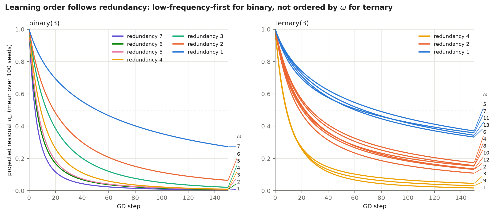
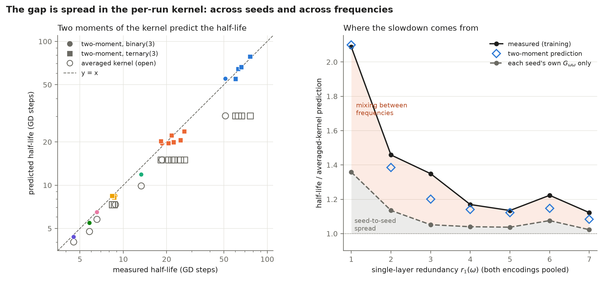
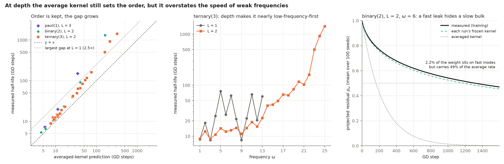

# QNN frequency-order MVP

A small numerical experiment on a 3-qubit data re-uploading quantum neural network (QNN). It asks what sets the order in which gradient descent learns the Fourier components of a target: the redundancy of each frequency, low frequency first, or the target's amplitude.

The model output is a Fourier series, f(x) = Σ_ω c_ω(θ) e^{iωx}. The redundancy r₁(ω) is the number of pairs of encoding-generator eigenvalues that differ by ω. Three experiments separate the candidate answers, a fourth explains the remaining gap between theory and training, and a fifth repeats the training with more encoding layers:

1. **Theory check (no training).** Monte Carlo over Haar-random blocks tests the corrected variance formula for c_ω and the Fourier tangent kernel identity, against the naive prediction "rate ∝ R(ω)".
2. **Learning order.** The same circuit is trained with a binary encoding (redundancy falls with ω) and a ternary encoding (redundancy is not monotone in ω).
3. **Amplitude.** One frequency is given 9× the amplitude of the others, and two metrics are compared.
4. **Kernel gap (no extra training).** Training is up to 2.2× slower than the averaged kernel predicts (2.5× for the slowest single frequency). The half-lives are recomputed under finer kernel approximations to locate where the slowdown comes from.
5. **Depth.** Training with L = 2 and 3 encoding layers, including 1- and 2-qubit circuits where the corrected formula and the naive count R(ω) disagree by up to 3×.

## How to run

```
python -m venv .venv
.venv/bin/pip install -r requirements.txt
.venv/bin/python run_all.py      # about 75 s on a laptop CPU (experiment 5 is ~55 s of it)
.venv/bin/python -m pytest       # 9 fast tests, no training
```

Python ≥ 3.10, CPU only. `run_all.py` regenerates `results/` and `figures/` from scratch and rewrites the acceptance table below.

## Figures

**Figure 1.** At L ≥ 2 the Monte Carlo variance of c_ω follows the corrected formula; R(ω) overestimates the low frequencies by up to 2.5×.


**Figure 2.** Frequencies are learned in order of redundancy: that is low-frequency-first for the binary encoding, but for the ternary encoding ω = 9 (redundancy 4) is learned long before ω = 5 (redundancy 1).



**Figure 3.** The averaged kernel predicts the order of the half-lives but underestimates them, by more as redundancy falls (left); each run's own kernel, frozen at initialisation, reproduces that run's trajectory (right).


**Figure 4.** Giving ω = 5 nine times the amplitude leaves the projected half-lives close to the y = x line (left), while under the relative-error metric the other frequencies appear slower and ω = 5 faster (right).


**Figure 5.** Two moments of the frozen kernel, E[G_ωω] and E[(G²)_ωω], predict each half-life to within about 6% on average, against 21–35% for the averaged kernel (left). Part of the slowdown is the spread of G_ωω across seeds; the larger part, at every redundancy, is mixing between frequencies within each run's kernel (right).



**Figure 6.** With more encoding layers the measured half-lives still follow the averaged-kernel order, but weak frequencies train up to 8× slower than it predicts, against at most 2.5× at L = 1 (left). For ternary(3), depth smooths the redundancy pattern, so the order becomes nearly low-frequency-first (middle). In a weak frequency, a small share of weight on fast modes drains in the first steps, leaving a slow bulk the average hides (right).



Colours in figure 6 denote the circuit configuration. Colours in figures 2–5 denote the single-layer redundancy r₁(ω). Figure 1 compares quantities at L ≥ 2, where r₁ is not the relevant grouping, so it uses neutral bars and two marker styles instead.

## Experiment 4: where the kernel gap comes from

Under the kernel frozen at initialisation, gradient descent acts on the Fourier residual as r ← (I − ηG) r, with G = J_c J_c^† the Fourier tangent kernel of that run. Averaging over the target's random phases, which are independent across frequencies, gives

ρ̄_ω(t) = E_seeds [(I − ηG)^t]_ωω = E_seeds Σ_n |U_ωn|² (1 − ηλ_n)^t,

a mixture of decays weighted by the local spectral measure of G at ω. Its mean rate is E[G_ωω], which is what the averaged kernel uses. A mixture of decays with that mean always halves more slowly than a single decay at the mean rate. The spread has two sources: G_ωω varies from seed to seed, and within a seed the off-diagonal entries G_ωω′ spread ω's weight over eigenmodes with different rates.

| Approximation | What it keeps | Ternary half-life / averaged kernel (R = 4, 2, 1) |
| --- | --- | --- |
| Averaged kernel | E[G_ωω] only | 1, 1, 1 |
| Each seed's own G_ωω | seed-to-seed spread | 1.04, 1.14, 1.38 |
| Each seed's full G, phase-averaged | spread and mixing between frequencies | close to measured (mean error 6%) |
| Measured (training) | everything | 1.16, 1.49, 2.19 |

On a log scale, the seed-to-seed spread accounts for 25%, 33% and 41% of the slowdown for R = 4, 2, 1. Mixing between frequencies accounts for the rest. Fitting a Gamma distribution to the first two moments of the local spectral measure gives a closed-form half-life, k(2^{1/k} − 1)/κ with k = m₁²/(m₂ − m₁²) and κ = −log(1 − ηm₁). It predicts the measured half-lives with a mean error of 5.5% (binary) and 6.1% (ternary).

Experiment 4 compares continuous crossing times, interpolated between steps, rather than the whole-step half-lives of experiments 2–3. The averaged-kernel baseline uses discrete-time decay. Without both, rounding up to the next step makes the fast frequencies (5–9 steps) look 5–20% slower than they are.

Open questions:

- m₂ = E[(G²)_ωω] is measured here, not derived. A Haar-average (Weingarten) formula for it, like the one for m₁, would make the half-life prediction fully analytic.
- At equal redundancy, the binary encoding's R = 1 frequency (ω = 7) slows down less (1.69×) than the ternary R = 1 frequencies (2.19×). Redundancy alone does not fix the size of the mixing.

## Experiment 5: more encoding layers

Experiment 1 showed that at L ≥ 2 the naive count R(ω) misstates the variance of c_ω and the corrected formula gets it right, but nothing was trained at L ≥ 2. Two facts shape the test:

- At 3 qubits the two formulas predict ratios within about 6% of each other, because the correction removes one path out of d at ω = 0. Telling them apart through training needs small circuits, so experiment 5 includes pauli(1) at L = 3 (d = 2) and binary(2) at L = 2 (d = 4), alongside ternary(3) at L = 2.
- Weak frequencies become very slow with depth. The averaged kernel predicts about 1,300 steps for the top frequency of ternary(3) at L = 2, which is not reached within the 2,000 steps run.

Results (100 seeds each, amplitude 0.002, η = 0.2):

| | pauli(1), L = 3 | binary(2), L = 2 | ternary(3), L = 2 |
| --- | --- | --- | --- |
| Measured E[G_ωω] / corrected formula | 0.95–1.18 | 0.98–1.09 | 0.96–1.28 |
| Naive R(ω), matched at ω = 1, off by up to | 2.96× | 1.28× | 1.34× |
| Largest measured / averaged-kernel half-life | 4.3× | 8.1× | 4.4× |
| Each run's frozen kernel vs measured, mean error | 8.7% | 3.5% | 5.2% |

- **The corrected formula holds at depth.** It matches the measured mean kernel everywhere. The largest deviations (1.2–1.3×) are on the weakest frequencies, where 100 seeds give a noisy mean.
- **Order still follows the averaged kernel** (rank correlation 0.99 for ternary(3) at L = 2). Stacking layers smooths the redundancy pattern, so the ternary order also correlates 0.97 with ω itself, and the L = 1 signature (ω = 9 learned long before ω = 5) mostly disappears.
- **The timing gap grows with depth.** Weak frequencies train 4–8× slower than the averaged kernel predicts. Each run's own frozen kernel still reproduces training, so the runs stay in the lazy regime and the gap is again spread in the per-run kernel.
- **The extra slowdown comes from fast modes.** For the slowest learned frequency of binary(2) and ternary(3), about 2% of its local spectral weight sits on modes more than 10× faster than its mean rate, yet those carry 47–49% of E[G_ωω]. That part drains within a few steps; the remaining 98% decays at roughly half the average rate. In pauli(1) the effect is milder (10% of the rate), and mixing with moderately faster modes plays the larger role.
- **The experiment 4 two-moment predictor fails at depth** for weak frequencies, because the fast modes inflate E[(G²)_ωω]. A predictor for L ≥ 2 has to treat the fast and slow parts separately (see `IDEAS.md`).

## Acceptance checks

Expected values are from a prototype run with the reference core. The table is written by `run_all.py`; every number is also in `results/summary.json`.

<!-- ACCEPTANCE:START -->
| # | Check | Expected (prototype) | Measured | Result |
| --- | --- | --- | --- | --- |
| 1 | Exp 1: MC Var / predicted, every ω ≥ 1, all configurations | 0.88–1.08 | 0.881–1.077 | pass |
| 2 | Exp 1: MC kernel diagonal / ((L+1)(d²/2)·Var), every ω ≥ 1 | 0.95–1.05 | 0.951–1.052 | pass |
| 3 | Exp 1, pauli(1), L = 3: predicted Var at ω = 1, 2, 3 | 6/81, 3/81, 1/81 | 6/81, 3/81, 1/81 | pass |
| 4 | Exp 2 binary: half-lives for ω = 1…7 | 5, 6, 7, 9, 14, 19, 52 | 5, 6, 7, 9, 14, 19, 52 | pass |
| 5 | Exp 2 ternary: half-lives by redundancy group | R=4: 9; R=2: 19–27; R=1: 61–77 | R=4: 9–9; R=2: 19–27; R=1: 61–77 | pass |
| 6 | Exp 2 ternary: half-life(ω = 5) / half-life(ω = 9) | 8.6 | 8.56 | pass |
| 7 | Exp 2 ternary: seed-mean kernel diagonal × η vs predicted rate (0.0903, 0.0451, 0.0226 for R = 4, 2, 1) | largest deviation 10% | group means 0.0901, 0.0449, 0.0234; largest deviation 10.5% | pass |
| 8 | Exp 2 ternary: max over (t, ω) of seed-mean |r − r_frozen| / a | 0.007 | 0.00716 | pass |
| 9 | Exp 2 ternary: measured / predicted half-life, mean per group (R = 4, 2, 1) | 1.2, 1.5, 2.2 | 1.17, 1.49, 2.18 | pass |
| 10 | Exp 3: projected half-life, dominant / equal, every ω | 0.9–1.4 | 0.89–1.37 | pass |
| 11 | Exp 3: relative-error crossing time rises for the non-dominant ω | 12 of 12 rise, by 1.04–5.2× | 12 of 12 rise, ratios 1.04–5.19× | pass |
| 12 | Exp 3: relative-error crossing time of ω = 5 | falls from 94 to 69 | 94 → 69 | pass |
| 13 | Exp 4: two-moment prediction vs measured half-life, mean |relative error| (binary, ternary) | 5.5%, 6.1% (averaged kernel: 21%, 35%) | 5.5%, 6.1% (averaged kernel: 21%, 35%) | pass |
| 14 | Exp 4 ternary: half-life / averaged-kernel prediction, each seed's own G_ww only vs measured (R = 4, 2, 1) | 1.04, 1.14, 1.38 vs 1.16, 1.49, 2.19 | 1.04, 1.14, 1.38 vs 1.16, 1.49, 2.19 | pass |
| 15 | Exp 4: phase-averaged per-seed kernel vs measured half-life, mean |relative error| (binary, ternary) | 4.4%, 6.0% | 4.4%, 6.0% | pass |
| 16 | Exp 5: seed-mean kernel diagonal / corrected prediction, every ω, all depth configs (naive R(ω), matched at ω = 1, for contrast) | 0.95–1.28 (naive: off by up to 2.96×) | 0.95–1.28 (naive: off by up to 2.96×) | pass |
| 17 | Exp 5 ternary(3), L = 2: rank correlation of measured half-lives with the corrected prediction, and with ω | 0.99, 0.97 | 0.99, 0.97 | pass |
| 18 | Exp 5: largest measured / averaged-kernel half-life (pauli(1) L = 3, binary(2) L = 2, ternary(3) L = 2; L = 1 largest: 2.5) | 4.3, 8.1, 4.4 | 4.3, 8.1, 4.4 (L = 1: 2.5) | pass |
| 19 | Exp 5: each run's frozen kernel (phase-averaged) vs measured half-life, mean |relative error| per config | 8.7%, 3.5%, 5.2% | 8.7%, 3.5%, 5.2% | pass |
| 20 | Exp 5: slowest learned frequency (binary(2) L = 2 ω = 6; ternary(3) L = 2 ω = 25): share of local weight on fast modes / share of E[G_ωω] they carry | 2.2% / 49%; 2.0% / 47% | 2.2% / 49%; 2.0% / 47% | pass |

20 of 20 checks pass. Last full run: 72 s.
<!-- ACCEPTANCE:END -->

## Conventions

- Circuit U(x) = W_L S(x) … S(x) W_0 on |0…0⟩, with S(x) = diag(exp(−i x λ_j)) and W_l = V_l · expm(−(i/2) Σ_k θ_{l,k} P_k), where V_l is a fixed Haar-random unitary and P_k runs over all d² − 1 non-identity Pauli strings. θ = 0 at initialisation. Observable: Z on the first qubit.
- Training uses the zero-output model f = (f_A − f_B)/√2 (shared V_l, separate parameters), loss ½·mean over the grid of (f − y)², full-batch gradient descent with η = 0.2 for T = 300 steps, seeds 0–99.
- Grid x_j = 2πj/N with N = 2K + 3; c_ω is the FFT of f over the grid divided by N.
- Projected residual ρ_ω(t) = Re(r_ω(t)·conj(r_ω(0)))/|r_ω(0)|², averaged over seeds; its half-life is the first step with mean ρ_ω < 0.5 (experiments 4 and 5 use the interpolated crossing time instead). Relative error is |r_ω(t)|/|r_ω(0)|, summarised by the median over seeds.

## Layout

```
run_all.py            runs experiments 1-5, writes results/ and figures/
src/core.py           encodings, redundancy, theory predictions, model, training, kernels
src/experiments.py    the five experiments and the metrics
src/figures.py        the six figures
tests/test_core.py    unit tests
results/              one .npz per experiment, plus summary.json
figures/              six PNGs
IDEAS.md              parked ideas to revisit
```

## Limitations

- Each trainable block is a fixed Haar-random unitary times a fully parameterised SU(d) rotation, not a gate-level ansatz.
- Targets are tiny (coefficients 0.002–0.018), chosen so that training stays in the lazy regime.
- Plain full-batch gradient descent only.
- Training at L ≥ 2 covers three configurations only, and the slowest frequencies are not run to their half-lives.
- Noiseless statevector simulation.
- 3 qubits.
